<picture><source media="(prefers-color-scheme: dark)" srcset="assets/hero-dark.svg"></picture>

<picture><source media="(prefers-color-scheme: dark)" srcset="assets/social-l-dark.svg"></picture><a href="https://github.com/etowhite"><picture><source media="(prefers-color-scheme: dark)" srcset="assets/social-1-dark.svg"></picture></a><picture><source media="(prefers-color-scheme: dark)" srcset="assets/social-r-dark.svg"></picture>

<picture><source media="(prefers-color-scheme: dark)" srcset="assets/about-dark.svg"></picture>

<picture><source media="(prefers-color-scheme: dark)" srcset="assets/stack-dark.svg"></picture>

<a href="https://github.com/etowhite/quant-smart-fitness-dashboard"><picture><source media="(prefers-color-scheme: dark)" srcset="assets/project-quant-smart-fitness-dashboard-dark.svg"></picture></a>&nbsp;<a href="https://github.com/etowhite/asic-pulse"><picture><source media="(prefers-color-scheme: dark)" srcset="assets/project-asic-pulse-dark.svg"></picture></a>

<a href="https://github.com/etowhite/cyclone-mooneva"><picture><source media="(prefers-color-scheme: dark)" srcset="assets/project-cyclone-mooneva-dark.svg"></picture></a>

<picture><source media="(prefers-color-scheme: dark)" srcset="assets/stats-dark.svg"></picture>

<picture><source media="(prefers-color-scheme: dark)" srcset="assets/streak-dark.svg"></picture>

<picture><source media="(prefers-color-scheme: dark)" srcset="assets/wave-dark.svg"></picture>

<a href="https://github.com/etowhite?tab=repositories"><picture><source media="(prefers-color-scheme: dark)" srcset="assets/button-1-dark.svg"></picture></a>

<a href="https://metawka.github.io/expressive-profile/?from=etowhite"><picture><source media="(prefers-color-scheme: dark)" srcset="assets/credit-dark.svg"></picture></a>

